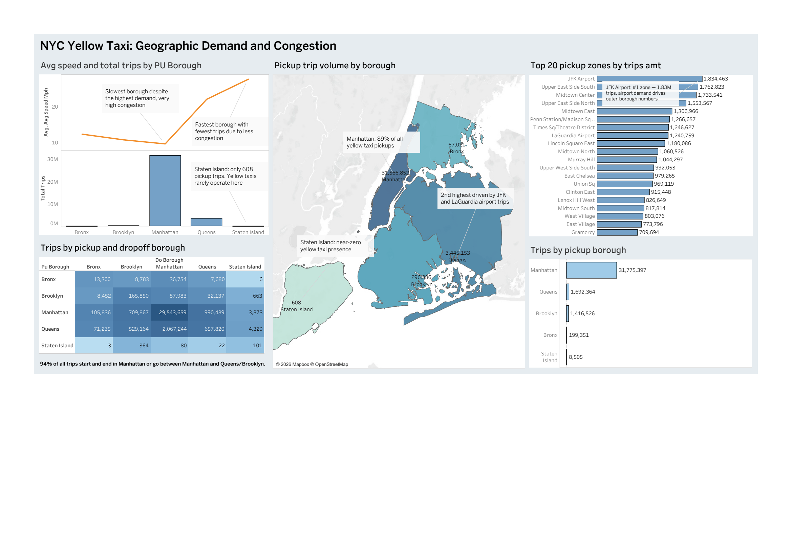

# NYC Taxi End to End Demand EDA


## Overview

A full end-to-end data analysis of **35.5 million NYC yellow taxi trips** taken in 2024.

This project covers the entire analyst workflow: raw data ingestion → SQL cleaning → Python aggregation → Tableau dashboards. The goal is to understand when, where, and how NYC yellow taxis are used, and what drives fare and tip behaviour.

---

## Dashboards

### Dashboard 1 — Demand Patterns
Explores when trips happen across hours, days, and months.


### Dashboard 2 — Geographic Demand and Congestion
Explores where trips originate, which zones are busiest, and how speed varies by borough.



### Dashboard 3 — Fares, Tips and Payment Behaviour
Explores how trips are paid, what drives fare costs, and how tips vary by borough.


---

## Key Findings & Business Implications

### Demand is concentrated in Manhattan and peaks at 6pm
89% of all 35.5M trips originate in Manhattan. Demand builds steadily from 6am, peaks sharply at 6pm on weekdays, then drops off. On weekends, demand shifts later into the night.

> **What this means:** Yellow taxi supply and driver scheduling should be heavily weighted toward Manhattan during evening hours. Fleet operators and dispatch platforms should prioritise Manhattan coverage from 4–8pm on weekdays. Outer boroughs are underserved — there is a gap that app-based ride-hailing (Uber, Lyft) has filled that yellow taxis have not.

---

### August is the slowest month, October the busiest
August recorded 2.59M trips — the lowest of the year. October peaked at 3.29M. The pattern dips in winter (Jan–Feb), recovers in spring, dips again in summer, then peaks in autumn.

> **What this means:** Taxi companies and drivers can use this seasonal pattern to plan maintenance windows in August when demand is lowest, and maximise availability in October. Pricing models could apply mild surge pricing during peak months to capture higher willingness to pay.

---

### JFK Airport is the single busiest pickup zone in the dataset
JFK recorded 1.83M trips — more than any Manhattan neighbourhood zone. LaGuardia added 1.24M. Together the two airports account for over 3M trips.

> **What this means:** Airport routes are a critical revenue segment. Taxi operators should ensure consistent airport coverage and fast pickup availability at JFK and LaGuardia. The JFK flat-rate fare ($65.21 average) provides predictability for both drivers and passengers — this model could be extended to LaGuardia to reduce fare uncertainty and increase rider confidence.

---

### Newark airport fares average 6× a standard trip
Newark averages $94.65 per trip versus $15.11 for a non-airport trip. JFK averages $65.21, LaGuardia $44.61.

> **What this means:** Airport trips, especially Newark, are disproportionately high-value. Drivers who specialise in airport routes earn significantly more per trip. Platforms could incentivise drivers to accept airport dispatch during peak travel periods (Friday afternoons, Sunday evenings) to reduce wait times and improve passenger experience on the highest-value routes.

---

### 84% of trips are paid by card — cash is nearly gone
Cash accounts for only 14.6% of transactions. Credit card dominates at 84%.

> **What this means:** Investment in cash handling infrastructure (change, cash registers, cash reconciliation) is no longer justified. Resources should shift toward card terminal reliability, contactless payment, and in-app payment integration. Any friction in card payment directly impacts the majority of transactions.

---

### Tip rates vary sharply by borough — Brooklyn and Bronx riders tip far less
On card payments, Manhattan averages 25.6% tip. Queens 21.8%, Brooklyn 7.6%, Bronx 1.4%.

> **What this means:** The low tip rates in Brooklyn and Bronx likely reflect a combination of lower average incomes and stronger cash payment habits in those areas — cash tips are not captured in this dataset, so the true tip rate may be higher. However, if the disparity is real, driver incentive structures should account for this — drivers dispatched to outer boroughs are likely earning less per trip in both fare and tip. Platforms could use tip rate data to design fairer driver compensation that does not penalise drivers for serving lower-income areas.

---

### Manhattan is the slowest borough despite the highest demand
Manhattan averages ~10 mph. Staten Island averages ~32 mph with almost no taxi activity.

> **What this means:** Congestion directly erodes driver earnings — a slower trip means fewer trips per hour and lower hourly income. This supports the case for congestion-based pricing (which NYC has since introduced with the congestion pricing zone). For fleet operators, trip efficiency metrics (revenue per hour, not just revenue per trip) should be tracked to give a true picture of driver profitability in dense vs outer borough routes.

---

## Project Structure

```
├── dashboards/          # Dashboard PDFs and PNG screenshots
├── data/
│   ├── raw/             # Raw TLC trip data (not included — see note below)
│   └── processed/       # Processed aggregation outputs
├── docs/                # Tableau workbook (.twbx)
├── notebooks/
│   ├── 01_ingestion     # Load raw Parquet files into PostgreSQL
│   ├── 02_profiling     # Exploratory data analysis and profiling
│   └── 03_checks_and_export  # Data quality checks and CSV export
├── reports/             # EDA charts (distributions, correlations, boxplots)
├── sql/
│   ├── 01_create_tables # Schema creation
│   ├── 02_clean_tables  # Data cleaning and filtering
│   ├── 03_zone_join     # Join taxi zone lookup
│   └── 04_analysis      # Aggregation queries for all 17 output tables
└── tableau_data/        # 17 aggregated CSV files used in Tableau
```

---

## Data

**Source:** [NYC Taxi and Limousine Commission (TLC) Trip Record Data](https://www.nyc.gov/site/tlc/about/tlc-trip-record-data.page)

**Period:** January 2024 – December 2024

**Raw data not included** in this repository due to file size (several GB of monthly Parquet files). Download the 2024 yellow taxi files from the TLC link above and place them in `data/raw/` before running the notebooks.

---

## How to Run

1. Download 2024 yellow taxi Parquet files from the TLC and place in `data/raw/`
2. Set up a PostgreSQL database and update the connection string in `notebooks/01_ingestion.ipynb`
3. Run notebooks in order: `01` → `02` → `03`
4. Run SQL scripts in order: `01` → `02` → `03` → `04`
5. Open `docs/Taxi_tableau.twbx` in Tableau Desktop to view the dashboards

---

## Author

**Levon Seneres**
[github.com/Levon-Seneres](https://github.com/Levon-Seneres)
