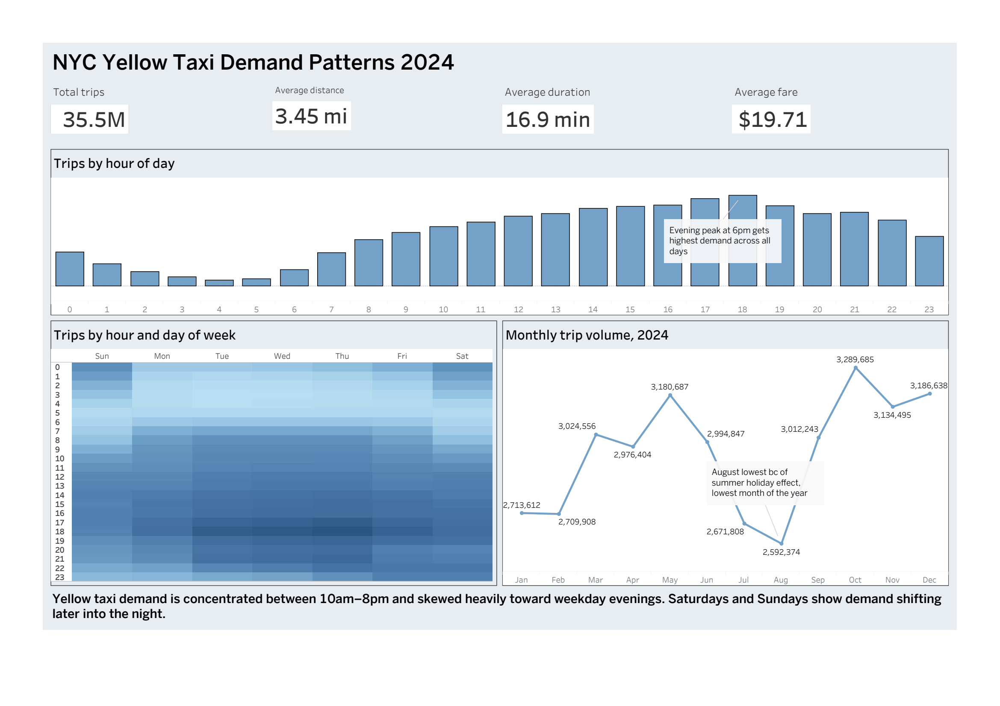
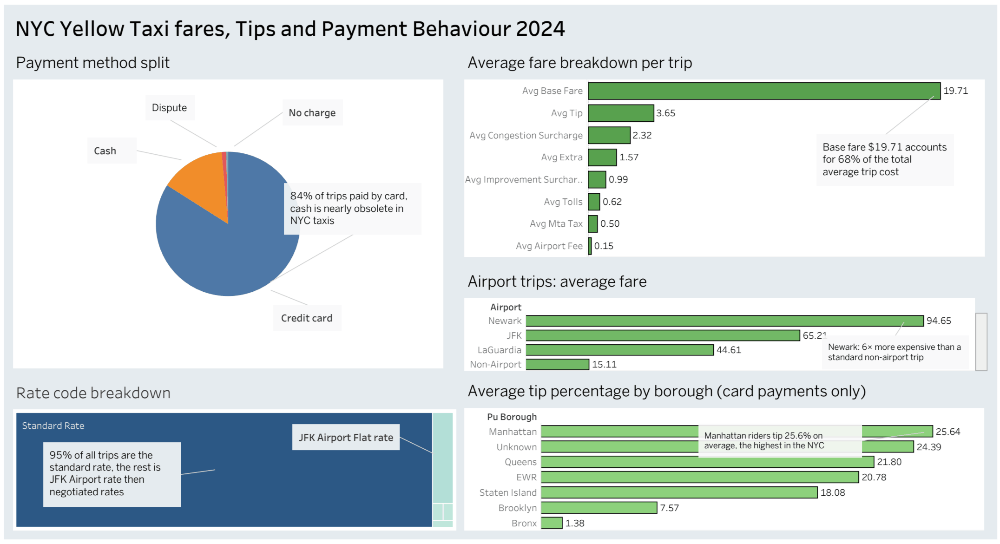

# NYC Taxi End to End Demand EDA


## Overview

A full end-to-end data analysis of **35.5 million NYC yellow taxi trips** taken in 2024.

This project covers the entire analyst workflow: raw data ingestion → SQL cleaning → Python aggregation → Tableau dashboards. The goal is to understand when, where, and how NYC yellow taxis are used, and what drives fare and tip behaviour.

---

## Dashboards

### Dashboard 1 — Demand Patterns
Explores when trips happen across hours, days, and months.



### Dashboard 2 — Geographic Demand and Congestion
Explores where trips originate, which zones are busiest, and how speed varies by borough.


### Dashboard 3 — Fares, Tips and Payment Behaviour
Explores how trips are paid, what drives fare costs, and how tips vary by borough.



---

## Key Findings

- **Yellow taxis are a Manhattan service.** 89% of all 35.5M trips originate in Manhattan. Outer boroughs have near-zero yellow taxi presence, with Staten Island recording only 608 pickups for the entire year.

- **Demand peaks at 6pm.** Trip volume builds steadily from 6am, peaks at 6pm across all weekdays, then drops off. On Saturdays and Sundays, demand shifts later into the night.

- **August is the slowest month, October the busiest.** August recorded 2.59M trips — the lowest of the year — likely due to summer holidays. October peaked at 3.29M trips.

- **JFK Airport is the single busiest pickup zone.** With 1.83M trips, JFK outranks every Manhattan neighbourhood zone in the dataset.

- **Newark airport fares are 6× a standard trip.** The average Newark fare is $94.65 versus $15.11 for a non-airport trip. JFK averages $65.21 and LaGuardia $44.61.

- **84% of trips are paid by card.** Cash accounts for only 14.6% of transactions, showing a strong shift toward cashless payments.

- **Manhattan riders tip the most, Bronx the least.** On card payments, Manhattan averages 25.6% tip. Brooklyn averages 7.6% and Bronx 1.4%, pointing to differences in rider demographics across boroughs.

- **More demand = slower speed.** Manhattan averages ~10 mph despite having the highest trip volume. Staten Island averages ~32 mph with almost no taxi activity — a direct reflection of congestion levels.

---

## Project Structure

```
├── dashboards/          # Dashboard PDFs and PNG screenshots
├── data/
│   ├── raw/             # Raw TLC trip data (not included — see note below)
│   └── processed/       # Processed aggregation outputs
├── docs/                # Tableau workbook (.twbx)
├── notebooks/
│   ├── 01_ingestion     # Load raw Parquet files into PostgreSQL
│   ├── 02_profiling     # Exploratory data analysis and profiling
│   └── 03_checks_and_export  # Data quality checks and CSV export
├── reports/             # EDA charts (distributions, correlations, boxplots)
├── sql/
│   ├── 01_create_tables # Schema creation
│   ├── 02_clean_tables  # Data cleaning and filtering
│   ├── 03_zone_join     # Join taxi zone lookup
│   └── 04_analysis      # Aggregation queries for all 17 output tables
└── tableau_data/        # 17 aggregated CSV files used in Tableau
```

---

## Data

**Source:** [NYC Taxi and Limousine Commission (TLC) Trip Record Data](https://www.nyc.gov/site/tlc/about/tlc-trip-record-data.page)

**Period:** January 2024 – December 2024

**Raw data not included** in this repository due to file size (several GB of monthly Parquet files). Download the 2024 yellow taxi files from the TLC link above and place them in `data/raw/` before running the notebooks.

---

## How to Run

1. Download 2024 yellow taxi Parquet files from the TLC and place in `data/raw/`
2. Set up a PostgreSQL database and update the connection string in `notebooks/01_ingestion.ipynb`
3. Run notebooks in order: `01` → `02` → `03`
4. Run SQL scripts in order: `01` → `02` → `03` → `04`
5. Open `docs/Taxi_tableau.twbx` in Tableau Desktop to view the dashboards

---

## Author

**Levon Seneres**
[github.com/Levon-Seneres](https://github.com/Levon-Seneres)
